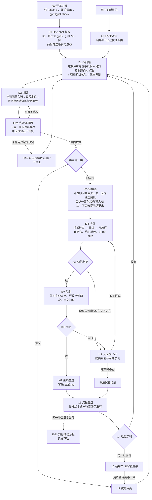

# 迭代准则：怎么把研究成果一步步改到标准要的样子

由 `D:\musicclaude\_thread_evo_20261019\迭代准则.md`（11-12 版，八步 + I02a/I15/I16）改写到本项目。音乐专属的东西（珠子、线、两首同跑、画面）换成了科研的对应物；结构、判定纪律和"自己改自己"的规矩照搬。

**地位**：仅次于 `标准.md`。标准定成果要做到什么，这份定怎么改流水线。
**谁能改**：我（Agent）可以照第八节改；第八节列的几样不能动。
**严格按流程图走**：`STATUS.md` 最上面固定一行"现在在流程图哪一步、下一步是什么"，每走完一个节点就改；要做的事在图上找不到，先补图再做。
**压缩或接续之后**：先读 `STATUS.md`、`要求清单.md`、这份准则第三节和第六节，再动手。

## 一、目标、层和文件

成品：针对一个研究问题的研究报告（正文 + 结构化附录：证据表、结论表、竞争性假说表）。首个研究问题见 `总任务书.md`。

流水线的层（诊断时"问题出在哪一层"就在这里面找）：

| 层 | 做什么 | 现在谁做 |
|---|---|---|
| L1 检索 | 找到该读的文献、交叉方向 | gpt3 出检索式 + 本地 Europe PMC/PubMed 执行 + gpt3/gpt4 筛摘要（用户 11-13："这两个他可能有些论文查的不够"，所以不只靠模型自带联网） |
| L2 获取 | 拿到全文 | `tools/fetch.py`：本地 Europe PMC 开放全文 → 不行的一次性交给 codex luna |
| L3 阅读提取 | 从原文提取研究条件、结果、效应 | gpt3（有全文时带附件） |
| L4 综合 | 处理矛盾、方法学限制、机制模型、假说 | gpt3 |
| L5 写作与结构 | 正文、附录、编号引用闭合 | gpt3 |
| 测法 | 评委和机械检查 | 见第七节 |
| 设定 | 提示词、标准、准则里的每一条"必须/不许" | `设定登记.md` |

| 文件 | 管什么 | 谁写 |
|---|---|---|
| `标准.md` | 成果要做到什么 | 只有用户 |
| `总任务书.md` | 目的、授权边界 | 用户（来源见文件头） |
| `迭代准则.md` | 怎么改流水线 | 我，照第八节 |
| `主线.md` | 现行主线：用哪个流程、哪几个提示词、哪个模型；修订记录只记收下的改动 | I09 |
| `猜想台账.md` | 一个问题一节：每条猜想、谁提的、怎么验证、结果、状态 | I02 前读；新猜想当场登记 |
| `试验记录.md` | 每个试过的方案：假设、改了什么、结果、原因、结论 | I05、I08、I13 |
| `要求清单.md` | 用户每条要求的原话和状态 | 用户每提一条就记 |
| `流程复盘.md` | 每轮复盘记分表、流程改动台账 | I15 |
| `用户判定.md` | 用户（或领域专家）对成果的评判原话 | I10 |
| `设定登记.md` | 每条设定：内容、写在哪、谁定的、能不能改 | 新写或改提示词时对一遍 |
| `STATUS.md` | 现在在哪 | 每一步覆盖更新 |
| `runs/` | 每次模型调用（提示词、回答、耗时），`runs/calls.jsonl` 汇总 | `tools/llm.py` 自动 |
| `out/<版本名>/` | 每一版成果和它的全部测量 | `tools/run.py` |

## 二、硬约束（任何方案都要逐条查）

1. **泛化**：提示词、评审、规则里不放具体研究问题的答案或例子；换一个研究问题（例如 GPi-DBS 与肌张力障碍）也能照样跑。研究问题只从 `--question` 进来。
2. 成果全部由流水线产出，不经人手修改。
3. 引用必须真实：每条引用要有 PMID 或 DOI，机械核验查不到的引用算硬检查不过。
4. 不能把模型之间的共识写成实验验证；推断和假说必须标明证据状态。
5. 允许联网。
6. **下载只用合法开放来源**（PMC/Europe PMC、出版社开放获取、作者公开版本、预印本）。不用 Sci-Hub 一类来源。
7. **luna 少用**：codex（`gpt-6-luna`，max）只做下载这类 gpt3 做不了的机械活；每批最多一次调用，用量记 `runs/luna_calls.jsonl`。分析、评审、写作一律走 gpt3/gpt4。
8. **审核状态**（AROS 3.3）：证据、结论、假说的 `review_status` 只有研究者在工作台（`streamlit run tools/workbench.py`）里能设成 verified / rejected；流水线写入一律 pending。原文不可被 AI 覆盖；每条证据要带原文摘句，`quotecheck` 查不到的证据不能单独支撑结论。

## 三、流程

**三组对照（AROS 方案 7.2）**：A = `B0`（通用模型直接做）；B = `B1`（同一提示词 + 系统检索到的同一批材料作为附件，`run.py material --tag B1 --src <系统版本>`）；C = 系统版本（S1、S2……）。C 只赢 A 不赢 B，说明收益来自材料而不是流程，下一步改 L1/L2 而不是加流程。每个系统版本都要和 A、B 各盲比一次。

**留出验收题**：`questions/Q2.md`（AROS 第 10 节最终验收题原文）只在宣布收敛前跑一次，不用来调提示词、不看它的结果改流程；迭代只用 Q1（AROS T10："保留盲测任务，测试集不用于开发"）。

**B0 是所有实验的第一条基线**（11-13 对话："One-shot 应该是你们所有实验的第一条基线"）。如果 B0 在 I01 里已经挑不出大问题，直接走 I14 → I10，不启动后面的迭代。

## 四、节点

| 节点 | 做什么 |
|---|---|
| I00 | 读 `STATUS.md`、`要求清单.md`；`gpt3 check --json`、`gpt4 check --json`；确认没有别的会话在改同一批文件；musicclaude 也在用同一账号，并发别开太大（`tools/llm.py` 默认每账号间隔 7 秒） |
| B0 | `python tools/run.py oneshot --tag B0`：同一份提示词（`prompts/oneshot.txt` + 研究问题 + 标准），gpt3、gpt4 各一份（`B0_gpt3`、`B0_gpt4`），都是 GPT-6 Thinking max、允许联网。这是"原生模型充分自主执行"的基线，提示词只给目的和标准，不给做法 |
| I01 | 四个来源并列：开放评审（`run.py review`，GPT-6、GPT-5.6 两位，只找问题、不打分、不给检查单）；绝对验收（按 `标准.md` 逐条判，门槛评委）；引用机械核验（`run.py refcheck`，PubMed/Europe PMC 查 PMID、DOI、标题）；我自己通读。结果合起来写进 STATUS 的"待修的问题" |
| I02 | 先读 `猜想台账.md` 这个问题的一节。四项定位（一小时内出结果，做出来的是诊断样本，不进主线）：① **做得出来吗**：不管现有设定，让模型用最省事的办法写一份没有这个问题的样本，交给报问题的评委；评委仍然报就先校准评委。② **卡在哪条设定**：`设定登记.md` 里相关的设定一条条单独放开。③ **从哪一层开始有**：沿 L1→L5 查中间产物（检索到的文献清单、全文有没有拿到、提取表、综合），找问题第一次出现的那一层。④ **评委分得开吗**：同一版测两次加第①项样本，看报得稳不稳。四项结果交两位顾问（gpt3 GPT-6、gpt4 GPT-5.6，各自独立）问根因假设；设定写成"现在的设定（谁定的）"，不写成约束 |
| I02a | 每批开批前都做。"看到什么算成立"在跑之前写下。四项里至少一项指出位置才出方案；每套方案写明对应哪一项结果，空着不开批 |
| I03 | 每位顾问至少三套，互为独立假设：针对哪个已验证的原因、只改什么、和别套的区别、预期在哪个测量上看到改善。至少一套改结构、输入、分工（例如：先出文献清单再拿全文再写；拆成检索/提取/综合三次调用；给全文附件），不只是在提示词里加要求。提示词由顾问出，我只查硬约束和查重 |
| I04 | 顺序固定：机械检查（引用核验 `refcheck`、正文引用核验 `bodycheck`、证据原句核对 `quotecheck`、附录编号闭合，免费）→ 评审和盲比之后跑 `factcheck`，评委的文献误读指控按全文裁定后才计入 → 我读 → 开放评审两位、绝对验收、对 B0 盲比（两种先后顺序）。一批候选同时跑 |
| I05 | 照第五节判：明显失败、接近、方向不成立、过 |
| I07 | 补：对当前主线盲比；绝对验收和盲比各补到 4 次（GPT-6、GPT-5.6 各两遍）；有全文时抽查 10 条结论对原文 |
| I08 | 用 I07 补齐的全部结果重算第五节过线条件，不沿用 I05 |
| I09 | 改动写进 `主线.md` |
| I12、I13 | 没过的候选一律交回提出它的顾问（写明结果、哪项没过、开放评审原话）；提出者写明"为什么不可能修成"才关，否则给改后的方案继续试，已过的指标不许退。同一方案交回三次仍无改善，发一行给用户（不停） |
| I14 | 见第五节收敛 |
| I10 | 见第六节 |
| I11 | 见第七节 |
| I15、I16 | 见第八节 |

## 五、判定线

**两种评委**
- 开放评审：不限制它说什么；两位（GPT-6 走 gpt3、GPT-5.6 走 gpt4）。每个候选都跑，不许停、不许改成照条打勾。只告诉它这是什么、想做到什么（总任务书目的 + 标准原文），并写明"上面没说到的问题，只要觉得不对也照样要说"。
- 门槛评委（绝对验收、盲比）：从标准派生，先校准（第七节）再用。

**候选过线**
1. 硬检查全过：引用核验无查不到的引用；附录编号闭合；硬约束 1–7。
2. 绝对验收：没有严重问题；中等问题比主线少，或一样多但更轻。
3. 盲比（两种先后顺序都测）：快筛对 B0，验收再对主线。没有"两位评委都稳定选旧"；理由对得上标准某条算退步，对不上触发 I11。分项（覆盖、证据、综合、分层、严谨）逐项看，某一项两位都输就算这一项退步。
4. 开放评审：大问题按根因并成清单，和主线对照，不许出现主线没有的大问题（不能靠换一个问题保持数目）。
5. 未校准的测法报的问题我逐条核过才算数；它们单独不能放行，也不能单独淘汰。

**问题的轻重**
- 大问题：结构性的——漏掉一整个重要证据方向、结论和原文不符、把相关写成因果、把假说写成定论、没有处理明显的矛盾、竞争性假说其实分不开（预测相同）、引用不实。
- 轻微：不影响结论的措辞、格式、个别非核心遗漏。
- 其余中等。

**收敛**：实际做出一版，开放评审两位挑不出大问题，绝对验收只剩轻微，引用核验全过。宣布之前要齐：用到的门槛评委都有校准记录；我自己通读过并和评委一致；`要求清单.md` 每条都标了状态。缺一样只能说"当前最好的一版，还差什么"。

**"方向对"** 只指在预先说好的主要指标上有超过波动（B0_gpt3 和 B0_gpt4 之间的差距）的改善。

## 六、什么时候找用户

只在这几种情况：宣布收敛之前（I10，带版本名、测量结果、剩余问题）；我读的结论和校准过的评委相反、两位顾问也定不了；标准没规定、定错会白干好几个小时的事；对标准的意见（I16）；账号、授权、需要付费或登录的文献来源；科学结论需要真实专家判断时。

**自动绊线**（发一行给用户，不停工）：同一个问题同一类改法失败两次，下一批以更上一类为主（提示词里的要求 → 生成结构和输入 → 分工 → 设定 → 测法）；同一方向约 3 小时最好版本中等问题没减少；通路连续零秒失败或一小时没有调用完成。

找用户不等于停工；约半小时没有答复就按自己的最好判断做，标明"未经用户确认"。

## 七、评委和测法的校准（I11）

| 评委或测法 | 管什么 | 用法 | 怎么校准 | 现状（11-13） |
|---|---|---|---|---|
| 开放评审（`prompts/open_review.txt`，GPT-6 + GPT-5.6） | 补想不到的问题；收敛的最终判据 | 每版必跑；看的是正文 + 结构化附录（`report_full.md`） | 同一版前后对照 | 11-13 纠正一次：第一次只给正文，GPT-6 把"附录缺失"排成头号大问题（附录其实在），结果作废（`out/B0_*/_无附录作废/`），改为正文 + 附录重跑 |
| 绝对验收（`prompts/abs_review.txt`） | 按标准逐条（标准 5、7 not_testable） | 门槛；中等数看 4 次平均，主线波动带约 ±2 | 每条标准各造一个"只坏这一条"的对照 | 11-13 校准一次：加"标准 5、7 测不了"；同一份报告 4 次中等 4–7，严重的事实性指控须 factcheck |
| 盲比（`prompts/blind.txt`） | 退步检查，总体和分项 | 门槛 | 自比判平；造坏的对照稳定选原版 | 初版，未校准 |
| 证据原句核对（`run.py quotecheck`） | 证据摘句能不能在全文/摘要里找到 | 硬检查（not_found 比例） | 混入改写过的摘句必须报出 | 机械，不用模型；PDF 全文暂不核对 |
| 正文引用核验（`run.py bodycheck`） | 正文每个引用是否在知识库；引用前那句话和被引文献证据的相似度（疑似挂错编号） | 机械，免费；相似度 <0.08 视为挂错，其余疑似交 factcheck | 11-13 对照：S3a 的 PMID 40635563（实为 40512756 的内容）被抓到（0.029）；泛泛总结句有误报 | 11-13 新建 |
| 指控核对（`run.py factcheck`） | 评委"误读/错引"指控是否成立 | 评审、盲比之后必跑；只有 judge_correct / both_partly 的指控计入 | 用已人工核过的 2 条（P5）做对照 | 11-13 新建并校准一次：改成分别判"报告有无依据""指控有无依据"；对照判 partly（比人工严，理由成立） |
| 引用核验（`run.py refcheck`） | 引用存不存在、标题对不对 | 硬检查 | 混入伪造 PMID、错配标题的对照必须报出 | 机械。11-13 对照：伪造 PMID、错配标题都报出；校准一次：Europe PMC 不收的期刊 DOI 误报 not_found，加 Crossref 兜底后消除 |
| 全文抽查（I07） | 结论和原文是否一致 | 验收 | 人为改错一条结论的对照必须报出 | 未建 |

必须校准的时候：新门槛评委用之前；淘汰理由对不上标准；我读的结论和评委相反；同一版两次测的差距比两版之间还大；用户/专家和评委不一致（以用户为准，对齐评委）。

## 八、流程自己改自己（I15、I16）

**I15 流程复盘**（每轮一批候选有结论后），写进 `流程复盘.md`：
0. 记分表：最好版本对上一轮的绝对验收中等数、开放评审大问题清单、盲比，各是变好/没变/变差；头号问题活过了几个版本；这一轮调用里诊断样本和候选各占多少；到期的流程改动兑现没有。最好版本没变好时，只回答：所有没成的方案共同没动过的东西有哪些（设定、输入、哪一层、哪个评委），逐条排进下一轮四项定位。
1. 调用时间花在哪了（`runs/calls.jsonl` 按阶段统计）？luna 用了几次？
2. 哪次淘汰或通过事后看是错的？
3. 哪条规则没被执行？
4. 下一轮怎么更快（只能是效果不变、更快）？
5. 以前的教训这一轮有没有再犯？

流程审查交两位顾问独立找漏洞（第一问"这一轮为什么没进步、流程哪一步该改"），由我定采不采纳，理由写进复盘。

**改准则的办法**：直接改正文，旧说法删掉，旧版另存 `迭代准则_备份_<日期><事由>前.md`；每条流程改动在 `流程复盘.md` 台账记起因、预期改善哪个数字、哪轮到期，到期没兑现就撤；同一目的一轮最多收两条。凡是让某次本来会做的试验、测量、交回不做了的，都算放宽类，要两位顾问独立印证并单独告诉用户。

**不能动的（只有用户能改）**：`标准.md`；收敛的定义；最后由用户/专家看成果；没过的方案交回提出者、提出者判不可能才关；开放评审每版必跑、不许关、不许改成不开放；B0 One-shot 作为第一条基线；luna 只做下载、少用。

**I16a 设定卡住**：单独放开这一条后问题明显消失、只差这一处、评委分得开、重测一样，才带前后样本问用户；等答复期间照现行设定做；回复含糊不当同意。
**I16b 标准条文冲突**：只提不改。

## 九、其余规则

1. 只有一条主线，成果只从主线出。
2. 找改法要大胆，判定要严，只比只差一处的版本。
3. 调用按编号缓存（`runs/<编号>/output.txt`）：改了提示词必须换编号（`tools/run.py` 用提示词哈希做编号后缀，自动换）。
4. 跑之前核对输入（打印读进提示词的字数和附件数，0 就停）。
5. 只报测到的；没测完就说做了一半。
6. 不守着：长调用放后台，只在完成、出错、有结论时报。
7. **版本库**（11-13 用户："搞个 github public 仓库 push 一下 之后都在上面改"）：仓库 https://github.com/restinnotes/fwlaozong （公开）。每走完一个判定节点（I05、I08、I09）、每次改准则/标准测法/提示词/代码，就提交并推送；提交说明写节点和结论。论文全文、调用原始输入输出（含全文）、知识库二进制、第三方方案原文不入库（`.gitignore`），新增的这类文件也一样；公开前查一遍个人信息。
